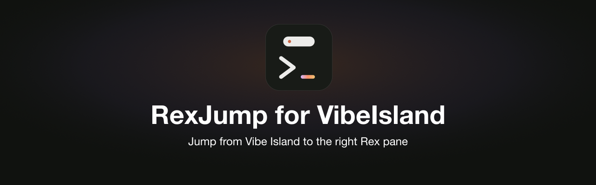

<p align="center">
  
</p>

# RexJump for VibeIsland

Click a session in [Vibe Island](https://vibeisland.app) and [Rex](https://www.superlogical.com/rex) jumps to the pane where that session runs.

Without this, Vibe Island only brings Rex to the front. With RexJump for VibeIsland you land on the right session, the right tab and the right pane, even with dozens open.

## What the app does

- Jumps to the exact pane in Rex where the agent runs on a click, and brings Rex Beta to the front.
- Works for every session Vibe Island shows, as long as it runs in Rex.
- Is fast: a jump takes about 0.1 seconds.
- Does nothing when no pane belongs to the session. It never opens a new or wrong pane.
- Runs invisibly in the background, without a Dock icon, and never twice.

## Installing

### From a release

Download `RexJump-for-VibeIsland-<version>.zip` and `rex.json` from the [latest release](../../releases/latest). The app is signed ad hoc and not notarized, so macOS blocks the first start of a downloaded copy.

```
unzip RexJump-for-VibeIsland-*.zip -d ~/Applications
xattr -dr com.apple.quarantine "$HOME/Applications/RexJump for VibeIsland.app"
mkdir -p ~/.vibe-island/integrations && cp rex.json ~/.vibe-island/integrations/rex.json
open "$HOME/Applications/RexJump for VibeIsland.app"
```

Then restart Vibe Island, because it only reads its integrations at startup.

### From source

You need Vibe Island 1.0.22 or newer (not the Mac App Store edition), Rex Beta and Xcode or the command line tools.

```
./install.sh
```

This builds the app if it does not exist yet, puts it in `~/Applications/RexJump for VibeIsland.app`, places the jump rule in `~/.vibe-island/integrations/rex.json` and starts the app. If the rule changed, restart Vibe Island, because it only reads its integrations at startup. The app starts by itself on the first click. The very first click after a restart of your Mac takes about half a second; after that it is instant.

When the app is in `~/Applications`, macOS also finds it through Spotlight. After a change in the code, run `./build.sh` and then `./install.sh`: the running version is stopped and replaced.

## Using it

Nothing: click a session in Vibe Island that runs in Rex.

To try it by hand, use the tty of a session:

```
open "rexjump://focus?pid=&tty=%2Fdev%2Fttys001"
```

## When it does not work

Every jump is in `~/Library/Logs/rexjump-for-vibeisland.log`:

| In the log | Meaning |
|---|---|
| no `url` line after a click | Vibe Island does not use the rule. Check that `rex.json` is in place and restart Vibe Island. |
| `done` | The jump succeeded. |
| `not found in Rex` | That session does not run in a Rex pane. Nothing was done. |
| `no pid or tty` | Vibe Island passed no data. Nothing was done. |
| `failed: …` | Something went wrong with Rex, for example a server that is not running. The message is included. |

## Uninstalling

```
pkill -f "RexJump for VibeIsland.app"
rm ~/.vibe-island/integrations/rex.json
rm -rf "$HOME/Applications/RexJump for VibeIsland.app"
```

Then restart Vibe Island.

## Development

Requires macOS, Xcode or the command line tools, Vibe Island and Rex Beta. There are no dependencies.

```
./build.sh                                           # build the app next to the scripts
./install.sh                                         # install, place the jump rule and start
pkill -f "RexJump for VibeIsland.app"                # stop the running app
tail -f ~/Library/Logs/rexjump-for-vibeisland.log    # follow the log
osascript -e 'tell application "Vibe Island" to quit'; open -a "Vibe Island"   # load the rule
```

A real click in Vibe Island cannot be tested from the terminal. Use `open "rexjump://focus?pid=&tty=…"` with the
tty of a session and read the log.

### The icon

The icon is an original design: a Vibe Island pill above a terminal prompt. `assets/icon.svg` is the
source, `assets/icon.png` the rendered version, `assets/icon-light.svg` the light variant, `Resources/RexJump for VibeIsland.icns` the app version and
`assets/readme-header.png` the image for the repository on GitHub.

### Pipelines

- **Pull request** (`.github/workflows/pull-request.yml`): checks the branch name, builds and validates the app
  on macOS and uploads the built app as an artifact of the run.
- **Release** (`.github/workflows/release.yml`): on every merge to `main` it determines the version, runs the
  same checks, builds the app with that version, zips it and creates a tag and GitHub release with the zip and
  `rex.json` attached.
- **Dependabot** updates the GitHub Actions weekly.

### Versioning

The version is determined by the release pipeline from the branch name of the pull request you merge:

| Branch name   | Version bump |
|---------------|--------------|
| `breaking/…`  | major        |
| `feature/…`   | minor        |
| `fix/…`       | patch        |

Merge with a merge commit (not squash), so the branch name is in the history. The title of the pull request
becomes the release notes. The version in `Info.plist` is filled in during the build and is not committed.
The pipeline starts from the latest `v<version>` tag.

### Building a release by hand

```
VERSION=1.2.3 ./build.sh
ditto -c -k --keepParent "RexJump for VibeIsland.app" RexJump-for-VibeIsland-1.2.3.zip
```

Without `VERSION` the app is built as `0.0.0-dev`.

## Limitations

- Only Rex Beta on macOS, with Vibe Island on the same Mac.
- Rex Beta runs under the bundle id `com.superlogical.rex`. If another build ever appears, change it in `Sources/RexApp.swift`.
- The app assumes version 10 of the Rex API. A much newer Rex may need changes.
- A built-in `rex://focus` in Rex would make this unnecessary. See `FEATURE-REQUEST.md`.

## Disclaimer

RexJump for VibeIsland is an independent project. It is not affiliated with, endorsed by or sponsored by Vibe Island or Superlogical (Rex). Vibe Island and Rex are the names of their respective owners and are used here only to say what this app works with.

## License

[MIT](LICENSE)
