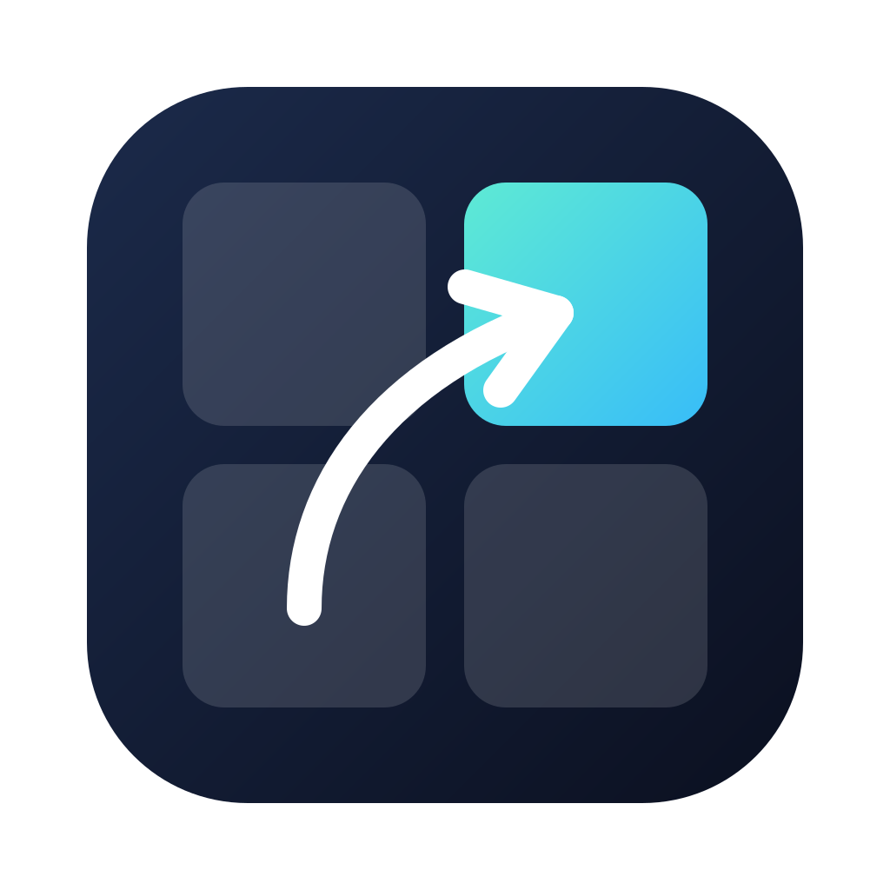

<p align="center"></p>

# Rex Jump

Klik in [Vibe Island](https://vibeisland.app) op een sessie en [Rex](https://www.superlogical.com/rex) springt naar de pane waar die sessie draait.

Zonder dit haalt Vibe Island Rex alleen naar voren. Met Rex Jump kom je op de juiste sessie, het juiste tabblad en de juiste pane terecht, ook als je er tientallen open hebt.

## Wat het kan

- Springt bij een klik naar de exacte pane in Rex waar de agent draait en haalt Rex Beta naar voren.
- Werkt voor elke sessie die Vibe Island toont, zolang die in Rex draait.
- Is snel: een sprong duurt ongeveer 0,1 seconde.
- Doet niets als er geen pane bij de sessie hoort. Er wordt nooit een nieuwe of verkeerde pane geopend.
- Draait onzichtbaar op de achtergrond, zonder dockicoon, en nooit dubbel.

## Installeren

Je hebt Vibe Island 1.0.22 of nieuwer nodig (niet de Mac App Store-editie), Rex Beta en Xcode of de command line tools.

```
./build.sh
cp vibe-island/rex.json ~/.vibe-island/integrations/rex.json
```

Herstart daarna Vibe Island, want die leest zijn integraties alleen bij het opstarten. Het appje start vanzelf bij de eerste klik. De allereerste klik na een herstart van je Mac duurt ongeveer een halve seconde; daarna is het direct.

`./build.sh` bouwt het appje, zet het in `~/Applications/RexJump.app` en start het. Daar vindt macOS het ook via Spotlight. Bouw je later opnieuw, dan wordt de draaiende versie eerst gestopt en vervangen.

## Gebruiken

Niets: klik in Vibe Island op een sessie die in Rex draait.

Handmatig proberen kan met de tty van een sessie:

```
open "rexjump://focus?pid=&tty=%2Fdev%2Fttys001"
```

## Als het niet werkt

Elke sprong staat in `~/Library/Logs/rex-vibe-island-jump.log`:

| In het log | Betekenis |
|---|---|
| geen `url`-regel na een klik | Vibe Island gebruikt de rule niet. Controleer of `rex.json` op zijn plek staat en herstart Vibe Island. |
| `klaar` | De sprong is gelukt. |
| `niet gevonden in Rex` | Die sessie draait niet in een Rex-pane. Er is niets gedaan. |
| `geen pid of tty` | Vibe Island gaf geen gegevens mee. Er is niets gedaan. |
| `mislukt: …` | Er ging iets mis met Rex, bijvoorbeeld een server die niet draait. De melding staat erbij. |

## Verwijderen

```
pkill -x RexJump
rm ~/.vibe-island/integrations/rex.json
```

Herstart daarna Vibe Island.

## Het icoon

Het icoon combineert dat van Vibe Island (de notch) met dat van Claude (de oranje badge). Het is samengesteld uit de iconen van de apps op deze Mac en zit als `icon/icon.png` in de repo. `Resources/RexJump.icns` is daar de appversie van, en `icon/social-preview.png` is het plaatje voor de repo op GitHub.

## Beperkingen

- Alleen Rex Beta op macOS, met Vibe Island op dezelfde Mac.
- Rex Beta draait onder de bundle id `com.superlogical.rex`. Staat er ooit een andere build, dan moet dat in `Sources/RexApp.swift` aangepast worden.
- Het appje gaat uit van versie 10 van de Rex-API. Een veel nieuwere Rex kan aanpassing vragen.
- Een ingebouwde `rex://focus` in Rex zou dit overbodig maken. Zie `FEATURE-REQUEST.md`.
